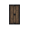
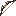
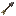

# Mannequins

Companion NPCs that follow you, fight for you, and wear whatever you give them.

<a class="card" href="spawning.html">

Spawning & Editing

Commands, the edit dialog, and equipment slots
</a>

<a class="card" href="combat.html">

Combat

Combat modes, shields, and assisting the owner
</a>

<a class="card" href="weapons.html">

Weapons

Melee, tridents, bows, and spears
</a>

<a class="card" href="movement.html">

Movement & Tracking

Following, anchoring, and head tracking
</a>

<a class="card" href="monsters.html">

Monster Attention

Why monsters keep targeting mannequins
</a>

## At a Glance

- Mannequins are owner-bound — only you can edit yours or swap its gear.
- Every mannequin is persistent and survives restarts.
- Mannequins render like a player, so they wear any skin, name, and equipment you give them.
