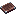
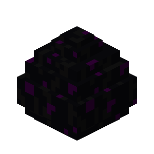
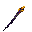
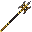

<!-- markdownlint-disable MD013 -->

# Weapons

Illyria adds custom weapons, crafted at a smithing table with an upgrade template.

Rarity: Rare · Legendary · Mythic

Nullspire
A needle of collapsed void, its violet core humming with nothingness.

<!-- TODO: src/img/item/nullspire.png is missing. Copy it from the resource pack texture once it
     exists. -->
Smithing Recipe

Stats<ul><li>20 Attack Damage</li><li>3.0 Attack Speed</li><li>+1 Knockback</li><li>+2 Reach</li><li>+20% Movement Speed</li></ul>

Abilities<ul><li>Blinds the target for 3s on hit</li></ul>

Arcane Staff
A staff humming with raw arcane energy. Crafted with a Netherite Upgrade Smithing Template.

Smithing Recipe

Stats<ul><li>+4 Armor Toughness</li><li>+40% Knockback Resistance</li></ul>

Abilities<ul><li>Right-click to launch a fireball</li><li>0.5s cooldown</li></ul>

Bluntsword
A heavy, unsharpened blade that crushes armor and bone.

Smithing Recipe

Bluntsword Upgrade TemplateSource: Wither Skeleton Chance: 1.5% (+0.5% per Looting)

Stats<ul><li>10 Attack Damage</li><li>1.6 Attack Speed</li></ul>

Greatsword
An oversized blade built for sweeping, devastating strikes.

Smithing Recipe

Greatsword Upgrade TemplateSource: Evoker Chance: 2% (+0.5% per Looting)

Stats<ul><li>12 Attack Damage</li><li>1.3 Attack Speed</li><li>-5% Movement Speed</li><li>+1 Knockback</li></ul>

Halberd
A long polearm designed to keep foes at a distance.

Smithing Recipe

Halberd Upgrade TemplateSource: Piglin Brute Chance: 1.5% (+0.5% per Looting)

Stats<ul><li>9 Attack Damage</li><li>1.8 Attack Speed</li><li>+2 Knockback</li></ul>

